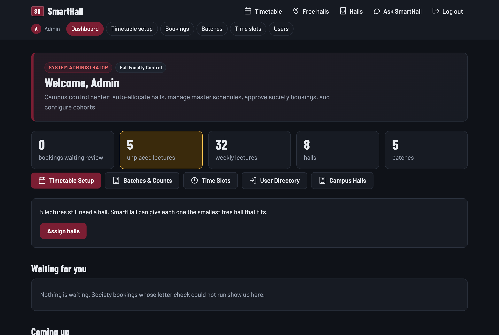
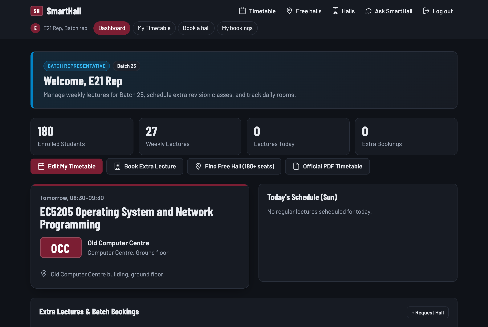
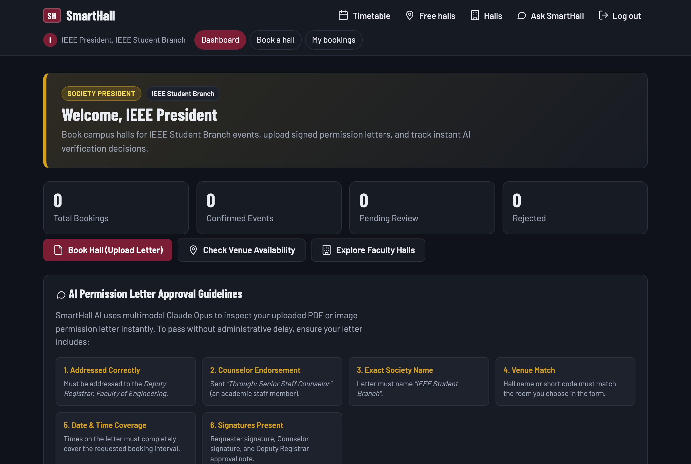

# SmartHall AI: Project Report
**University Hall Allocation, Navigation & AI Verification System**  
*Faculty of Engineering, University of Ruhuna (UOR-EFAC)*  
*Course Module: EC4307 — Web Application Development*

---

## Executive Summary
**SmartHall AI** is an intelligent, full-stack university hall allocation and campus navigation web platform engineered specifically for the Faculty of Engineering, University of Ruhuna. Prior to SmartHall AI, batch representatives, student societies, and university administrators relied on fragmented WhatsApp groups, manual spreadsheets, and physical paper permission letters to manage lecture halls and auditorium venues. This traditional approach resulted in frequent scheduling clashes, inefficient hall utilization, lost directions for junior batches, and multi-day delays in obtaining booking approvals.

SmartHall AI replaces this manual overhead with an automated, rule-governed web application featuring:
1. **Algorithmic Hall Auto-Allocation** to place master timetable lectures into appropriately sized halls.
2. **Real-time Clash Detection** preventing overlaps between fixed teaching schedules and ad-hoc event bookings.
3. **Automated PDF Timetable Ingestion** that parses official faculty timetable documents into live database records.
4. **Multimodal AI Letter Verification** using the Claude Opus API to check society booking permission letters.
5. **Real-Time Campus Board & Next Lecture Tracker** showing live venue availability and door-to-door directions.
6. **Natural Language Chatbot** providing instant database-backed answers to queries like *"free halls tomorrow at 10am for 120 students"*.
7. **Intentional High-Contrast Dark UI** designed for readability in lecture halls, low latency, and zero framework bloat.

---

## 1. Project Idea & Motivation: Why It Matters

### 1.1 The Operational Problem at UOR-EFAC
The Faculty of Engineering at the University of Ruhuna houses over 1,000 undergraduate engineering students across multiple academic batches (e.g., 25th, 26th, 27th, 28th batches) and diverse engineering disciplines (Computer, Electrical & Information, Civil, Mechanical). The physical campus infrastructure includes lecture halls, computer laboratories, drawing offices, and an auditorium:
- **MLT** (Main Lecture Theatre, 250 seats)
- **LH1 & LH2** (Lecture Hall Complex, 180 and 130 seats)
- **ECC** (Electrical Computer Centre, 90 seats)
- **NCC & OCC** (New and Old Computer Centres, 120 and 80 seats)
- **DO** (Drawing Office, 70 seats)
- **AUD** (Faculty Auditorium, 400 seats)

Managing these shared physical facilities previously suffered from three critical bottlenecks:
1. **Double Bookings & Scheduling Conflicts:** When batch reps rescheduled lectures or when societies planned evening workshops, manual coordination led to simultaneous bookings in the same room.
2. **Student Navigation & Awareness:** Incoming and junior students often struggled to locate venues spread across multiple faculty complexes (e.g., finding the Drawing Office inside the Civil Building vs. LH2 on the upper floor of the LHC).
3. **Paper-Based Bureaucracy:** Student societies (e.g., IEEE Student Branch, Mechanical Engineering Society) had to draft physical letters, obtain the signature of an academic staff counselor, deliver the document to the Deputy Registrar / Assistant Registrar for approval, and wait days for verification.

### 1.2 The SmartHall AI Solution
SmartHall AI establishes a single source of truth for the entire faculty. By digitalizing the master schedule, providing live availability tracking, parsing official administrative PDFs, and incorporating multimodal AI for document verification, the platform eliminates scheduling disputes, guarantees capacity matching, and makes hall accessibility transparent to every student and faculty member.

---

## 2. Technical Architecture & Technology Stack

SmartHall AI is designed as a **server-side rendered (SSR) monolithic application** prioritizing performance, security, and maintainability.

| Layer | Technologies Used | Rationale |
| :--- | :--- | :--- |
| **Backend Runtime** | Node.js (v20+ LTS) | Asynchronous, non-blocking I/O ideal for concurrent web traffic and quick database queries. |
| **Web Framework** | Express 5 | Robust routing, middleware chaining, and modern HTTP request handling. |
| **Database** | MySQL 8.0+ / `mysql2` | Strict relational schema, foreign key cascade constraints, unique compound indexes to guarantee zero double-bookings. |
| **Templating Engine** | EJS (Embedded JavaScript) | High-speed server-side rendering, semantic HTML output, and shared partials without heavy client bundles. |
| **Styling** | Vanilla Modern CSS | Custom CSS variables, glassmorphism backdrops, flex/grid layouts, responsive typography, and native dark mode. |
| **AI Integration** | Claude Opus (Anthropic SDK) & Gemini Flash | Multimodal letter inspection for signed PDFs/images and natural language query fallback for the chatbot. |
| **Document Processing** | Python 3 with `pypdf` | Precise bounding-box and coordinate-based extraction of faculty timetable matrices. |
| **Authentication & Security** | `bcryptjs`, `express-session` | Cryptographic password hashing (salt rounds = 10) and secure server-side session management. |

---

## 3. Comprehensive CRUD Operations

The system enforces strict Role-Based Access Control (RBAC) across three primary user tiers: **Admin**, **Batch Representative (Rep)**, and **Society President**, with open read access for **Students**.

### 3.1 Overview of System CRUD Operations

| Entity | Create (C) | Read (R) | Update (U) | Delete (D) | Access Control |
| :--- | :--- | :--- | :--- | :--- | :--- |
| **Halls** | Add new hall with capacity, building, floor, directions & photo | View hall list, details, live status, capacity & directions | Edit hall specifications, photo, and seating capacity | Delete hall (cascades bookings & unassigns lectures) | Admin (Write) / Public (Read) |
| **Batches** | Create new batch (e.g., 25th batch) with student count | View all batches and enrolled headcounts | Update batch name and student headcount | Delete batch (cascades all timetable entries) | Admin (Full) / Public (Read) |
| **Time Slots** | Add daily teaching slot (start time, end time, label) | View standard daily schedule grid | Modify start and end times with boundary validation | Delete slot (checks constraints) | Admin (Full) / Public (Read) |
| **Lectures (Timetable)** | Add individual lecture or batch-import via CSV / PDF | View batch weekly timetable, right-now status card | Edit lecture subject, assigned day, slot, or hall | Delete lecture with custom modal confirmation | Admin / Rep (Own Batch) |
| **PDF Timetables** | Upload official faculty timetable PDF / 1-click import | View published PDF in browser, download official file | Re-upload and replace batch timetable | Delete official PDF with custom modal confirmation | Admin (Write) / Public (Read) |
| **Hall Bookings** | Book hall for lecture (Rep) or society event with letter | View bookings list with status, filter by date/hall | Edit pending lecture bookings, Admin approve/reject/revoke | Cancel/Delete booking with modal confirmation | Rep / President / Admin |
| **Users** | Register new admin, rep, or president account | View user directory with batch/society mappings | Update credentials, batch assignments, or roles | Delete user (preserves integrity via SET NULL) | Admin |

### 3.2 Relational Integrity & Constraint Guarantees
To prevent human error and racial conditions in concurrent environments, SmartHall AI enforces database-level constraints:
- `UNIQUE KEY one_class_per_batch (batch_id, day_of_week, time_slot_id)`: Guarantees a batch cannot be scheduled for two classes at the same time.
- `UNIQUE KEY one_class_per_hall (hall_id, day_of_week, time_slot_id)`: Enforces that no two lectures share the same physical hall during the same teaching period.
- `CHECK (end_at > start_at)`: Validates that all ad-hoc bookings have logical chronological boundaries.
- `CHECK (capacity >= student_count)`: Software-enforced validation ensuring no batch is assigned to an undersized hall.

---

## 4. Distinctive & Advanced Engineering Features

### 4.1 Algorithmic Hall Auto-Allocation (`src/allocate.js`)
When an administrator uploads a master timetable CSV or PDF without pre-assigned venues, the auto-allocation engine assigns the most optimal hall for every lecture. This is formulated as a constrained combinatorial optimization problem:

$$\min \sum_{e \in E} \sum_{h \in H} x_{e, h} \cdot \Big( K(h) - c(e) \Big)$$

$$\text{subject to:}$$
1. **Capacity Feasibility:** 
   $$x_{e, h} = 1 \implies K(h) \ge c(e), \quad \forall e \in E, \; \forall h \in H$$
2. **Conflict Prevention (No Double Bookings):**
   $$\sum_{e \in E : d(e)=d, s(e)=s} x_{e, h} \le A(h, d, s), \quad \forall h \in H, \; \forall d \in \{1,\dots,5\}, \; \forall s \in S$$
3. **Unitary Assignment:**
   $$\sum_{h \in H} x_{e, h} \le 1, \quad \forall e \in E$$

where $E$ is the set of unplaced lectures, $H$ is the set of campus lecture halls, $K(h)$ is the hall capacity, $c(e)$ is the cohort headcount, and $A(h, d, s) \in \{0, 1\}$ denotes binary hall availability at day $d$ and time slot $s$.

1. **Sorting by Constraints:** Batches are sorted in descending order of student count to place the largest classes first where venue choices are most constrained.
2. **Best-Fit Heuristic:** The algorithm identifies the smallest available hall whose capacity $\ge$ batch student headcount, preventing smaller batches from needlessly occupying the 400-seat Auditorium or 250-seat MLT.
3. **Clash Avoidance:** Cross-references the taken slots matrix and returns a comprehensive allocation report highlighting any unplaced lectures.

### 4.2 Automated PDF Timetable Ingestion (`src/parsePdf.py` & `src/pdfTimetable.js`)
University timetables at UOR-EFAC are published as PDF documents (e.g., `9AxgTxnvgl0yADgsUzyUlvnY7uYnmrXrhK8mezyM.pdf`). SmartHall AI provides an integrated pipeline:
- **Coordinate-based Text Parsing:** Python's `pypdf` extracts text elements with their 2D geometric coordinates $(x, y)$, matching each entry into exact day columns and 1-hour time rows (`08:30–09:30`, `09:30–10:30`, etc.).
- **Course Code & Module Mapping:** Reads auxiliary notes to expand abbreviations (e.g., `EC5205` $\rightarrow$ *"EC5205 Operating System and Network Programming"*).
- **Venue Normalization:** Resolves faculty shorthand (e.g., `[LT1]` $\rightarrow$ `LH1`, `[CC]` $\rightarrow$ `OCC`).
- **One-Click Ingestion & Official Publishing:** Admin can import the document in 1 click, automatically populating the database and publishing the downloadable PDF on the student timetable page.

### 4.3 Multimodal AI Permission Letter Verification (`src/letterCheck.js`)
Society bookings require an official permission letter approved by faculty administration. SmartHall AI connects to the Claude Opus API with strict schema enforcement to verify:
1. Document addressee is the **Deputy Registrar, Faculty of Engineering**.
2. Document is routed **Through the academic staff counselor**.
3. Society name matches the logged-in president's organization.
4. Requested venue matches the selected hall.
5. Date and time boundaries match the booking request.
6. Required signatures (requester, counselor, and approval note/signature) are visually present.
If approved, the booking status automatically transitions to `approved`. If any rule fails, the booking is rejected with the exact reason provided by the AI.

### 4.4 New Semester Timetable Reset
At the transition between semesters, administrators need to wipe expired lecture allocations without re-creating batches, users, or halls. SmartHall AI provides a dedicated **"New Semester Reset"** tool allowing:
- Full reset across all batches or scoped reset for an individual batch.
- Optional automated cleanup of published timetable PDF documents.
- Safeguarded with an interactive modal confirmation UI to prevent accidental data loss.

---

## 5. Intelligent Chatbot Architecture (`src/chatbot.js`)

The SmartHall AI chatbot provides an accessible conversational interface for students and staff on mobile devices:

```
                      User Question:
       "Free halls tomorrow at 10am for 120 students"
                             │
                             ▼
               ┌───────────────────────────┐
               │ Rule-Based Parser (Regex) │
               │ Date, Time, Student Count │
               └─────────────┬─────────────┘
                             │
               Found all required parameters?
              ┌──────────────┴──────────────┐
             Yes                            No
              │                             │
              ▼                             ▼
   ┌──────────────────────┐    ┌──────────────────────────┐
   │ Live Database Query  │    │ Gemini Flash Fallback    │
   │ (Availability check) │    │ (Intent / Info extractor)│
   └──────────┬───────────┘    └────────────┬─────────────┘
              │                             │
              ▼                             ▼
   ┌──────────────────────────────────────────────────────┐
   │ Formatted Response: Free halls + Door Directions     │
   └──────────────────────────────────────────────────────┘
```

1. **Deterministic Rule Parser:** Uses regex to extract date (e.g., "today", "tomorrow", "25 Oct"), time (e.g., "10am", "14:30"), and headcount (e.g., "120 students", "60 seats") with zero API latency and zero cost.
2. **Database Verification:** Direct SQL queries check both `timetable_entries` and `bookings` tables to identify unoccupied halls whose capacity meets the requested student count.
3. **Contextual Directions:** The reply does not just list names; it appends physical directions (e.g., *"Lecture Hall 1 (LH1, 180 seats) — Lecture Hall Complex, turn right after the stairs"*).
4. **LLM Fallback (Gemini Flash):** If ambiguous phrasing is used, Gemini Flash extracts the parameters or answers general campus inquiries.

---

## 6. UI/UX Design Philosophy: Why the High-Contrast Dark Interface?

A prominent characteristic of SmartHall AI is its **custom, high-contrast dark visual identity**. This was a deliberate human-computer interaction (HCI) design choice based on the campus operating environment:

### 6.1 Environmental & Cognitive Rationale
1. **Low-Light Lecture Theatre Usability:** University lecture halls at UOR-EFAC are frequently darkened during slide presentations and projector use. A bright white interface causes harsh glare and pupil strain. The dark theme (`--bg: #0f1117`, `--surface: #181b24`) delivers comfortable contrast in lecture environments.
2. **Outdoor Sun Visibility:** Campus walkways in Galle are sun-exposed. High-contrast typography paired with distinct accent colors (`#f2b705` gold, `#22c55e` free green, `#ef4444` busy red) provides instantaneous readability in bright outdoor sunlight.
3. **Mobile OLED Battery Conservation:** Over 80% of student access occurs via smartphones. True dark mode significantly reduces OLED display power draw during long academic days.
4. **Physical Campus Signage Metaphor:** Hall badges throughout the interface (e.g., `LH1`, `MLT`, `AUD`) are styled as tactile physical doorplates, creating an intuitive cognitive link between what students see on their screens and the real physical plates on lecture hall doors.
5. **Zero Visual Noise & Instant Load Speeds:** Eliminating heavy JavaScript component libraries and CSS frameworks enabled a sub-100ms load time on spotty campus Wi-Fi connections, ensuring immediate access to room locations between consecutive lectures.

---

---

## 7. Dedicated Role-Based User Interfaces

To eliminate operational friction and prevent user confusion, SmartHall AI replaces generic monolithic dashboards with **specialized, role-tailored workspaces** for each authenticated user type: **System Administrator**, **Batch Representative (Rep)**, and **Society President**.

```
                        User Login (POST /login)
                                   │
                     Session Verification & Role Check
                                   │
        ┌──────────────────────────┼──────────────────────────┐
        ▼                          ▼                          ▼
  role === 'admin'           role === 'rep'           role === 'president'
        │                          │                          │
        ▼                          ▼                          ▼
Admin Dashboard (/admin)    Batch Workspace (/rep)    Society Portal (/president)
- Master Allocation Engine  - Cohort Headcount Card  - Event Pipeline Tracker
- Unplaced Lecture Resolv.  - Today's Class Timeline  - AI Letter Guidelines
- Faculty PDF Ingestion     - Next Lecture Countdown  - Letter Compliance Logs
- New Semester Wipes        - Fitting Halls (>= size) - Large Auditoriums Showcase
- Batch & Slot Controls     - Cohort Timetable Grid   - Ad-Hoc Event Bookings
```

### 7.1 Administrator Control Center (`/admin`)
- **Target Persona:** Faculty Timetable Committee, Assistant Registrar, Dean's Office (`admin@smarthall.test`).
- **Visual Identity:** Crimson accent header (`.role-banner.admin-banner`) with `SYSTEM ADMINISTRATOR | Full Faculty Control` badges.
- **Key Modules & Capabilities:**
  1. **Faculty Stat Monitor:** Real-time summary tiles showing pending booking requests, unplaced lectures requiring hall assignments, active weekly lectures, registered lecture halls, and enrolled academic batches.
  2. **One-Click Quick Actions Toolbar:** Instant navigation to *Timetable Setup*, *Batches & Counts*, *Time Slots*, *User Directory*, and *Campus Halls*.
  3. **Auto-Allocation Engine Panel:** Dispatches the constrained optimization algorithm to automatically pair all unplaced lectures with the smallest fitting free halls.
  4. **Master Timetable & PDF Ingestion:** Administrative controls to upload faculty PDFs, run coordinate extractions, and publish downloadable schedules.
  5. **New Semester Reset Tool:** Modal-protected utility for wiping expired timetable schedules selectively per batch or across the faculty.
  6. **Booking Approval Pipeline:** Direct review of society requests with AI permission letter verification summaries.


*Figure 7.1: Faculty Administrator Control Center (`/admin`) displaying active live stat tiles, pending approvals, and administrative shortcuts.*

### 7.2 Batch Representative Workspace (`/rep`)
- **Target Persona:** Elected Undergraduate Cohort Representatives, e.g., E21 / E22 Reps (`rep.e21@smarthall.test`).
- **Visual Identity:** Royal blue accent header (`.role-banner.rep-banner`) displaying `BATCH REPRESENTATIVE` and batch identification badge (e.g., `Batch 25 (E21)`).
- **Key Modules & Capabilities:**
  1. **Cohort Metric Cards:**
     - **Enrolled Cohort Size:** Displays official student headcount (e.g., *210 students*), automatically enforced during room allocations.
     - **Today's Lecture Counter:** Dynamic count of scheduled lectures for the current weekday.
     - **Real-Time Next Lecture Tracker:** Live indicator displaying what lecture is currently active or next up, including hall location.
     - **Active Bookings Tracker:** Direct link to reservations made by this representative.
  2. **Action Toolbar:** 1-click shortcuts to *Book Extra Lecture / Tutorial*, *Edit Batch Timetable*, *View Faculty PDF*, and *Check Available Halls*.
  3. **Today's Lecture Timeline:** Chronological list of day's classes with doorplate badges (`LH1`, `MLT`), time slots, module names, and lecturers.
  4. **Matching Campus Halls:** Automatically filters and displays only halls that physically fit the batch's headcount (capacity $\ge$ student count), preventing reps from requesting undersized rooms.
  5. **Batch Timetable Grid:** Scoped weekly schedule view dedicated exclusively to their cohort.


*Figure 7.2: Batch Representative Workspace (`/rep`) showing enrolled cohort strength (210 students), today's lecture schedule, live next lecture indicator, and fitting halls.*

### 7.3 Society President Portal (`/president`)
- **Target Persona:** Student Organization Leaders, e.g., IEEE Student Branch, Mechanical Engineering Society (`ieee@smarthall.test`).
- **Visual Identity:** University gold accent header (`.role-banner.president-banner`) displaying `SOCIETY PRESIDENT` and organization badge (e.g., `IEEE Student Branch`).
- **Key Modules & Capabilities:**
  1. **Event Reservation Pipeline:** Four-metric tracker showing *Total Society Reservations*, *Confirmed Venues*, *Under Review*, and *Rejected/Rescheduled* requests.
  2. **Event Actions Toolbar:** 1-click access to *Book Venue for Society Event*, *Ask SmartHall Assistant*, and *Browse Large Event Halls*.
  3. **AI Letter Compliance Guidelines:** Interactive guidance card grid explaining the 6 verification rules required by Claude Opus (Official Letterhead, Dean/AR Addressee, Senior Treasurer Endorsement, Accurate Date/Time matching, and Visual Signatures).
  4. **Society Booking History & AI Decision Logs:** Audit table listing upcoming society events with live status badges and detailed AI decision notes explaining why requests were approved or flagged.
  5. **Auditoriums & Large Gathering Spaces:** Dedicated showcase cards for large event venues (MLT, Faculty Auditorium, Drawing Office) with seating capacities and sound system amenities.


*Figure 7.3: Society President Portal (`/president`) featuring event reservation metrics, AI permission letter compliance guidelines, and large auditorium showcase.*

### 7.4 Dynamic Role-Tailored Navigation
The application header partial (`views/partials/header.ejs`) dynamically restructures its navigation links based on session authentication:
- **Public / Students:** *Timetable*, *Free halls*, *Halls*, *Ask SmartHall*, and *Log in*.
- **Admin:** Adds *Dashboard (`/admin`)*, *Timetable setup*, *Bookings*, *Batches*, *Time slots*, and *Users*.
- **Batch Rep:** Adds *Dashboard (`/rep`)*, *My Timetable*, *Book a hall*, and *My bookings*.
- **Society President:** Adds *Dashboard (`/president`)*, *Book a hall*, and *My bookings*.

---

## 8. Custom Confirmation Modal UI

To prevent accidental deletions without relying on browser-native `confirm()` popups, the platform features a custom HTML5 `<dialog>` modal:
- **Glassmorphic Backdrop:** Deep dark blurred overlay (`backdrop-filter: blur(8px)`).
- **Visual Danger Indicator:** Glowing circular badge with a red trash/alert icon.
- **Contextual Details:** Explains precisely which item is being deleted (batch name, subject, time slot).
- **Keyboard & Click Accessibility:** Full keyboard navigation (`Esc` dismiss) and backdrop click dismissal.
- **Universal Application:** Seamlessly protects timetable lectures, batches, slots, halls, bookings, and new semester resets.

---

## 9. Conclusion
SmartHall AI demonstrates how modern, lightweight web technologies and targeted AI integrations can solve real-world logistical bottlenecks in higher education institutions. By harmonizing algorithmic allocation, automated document parsing, multimodal AI verification, dedicated role-based interfaces, and an intentional user interface, the system provides the Faculty of Engineering, University of Ruhuna, with a dependable, state-of-the-art campus infrastructure management platform.
