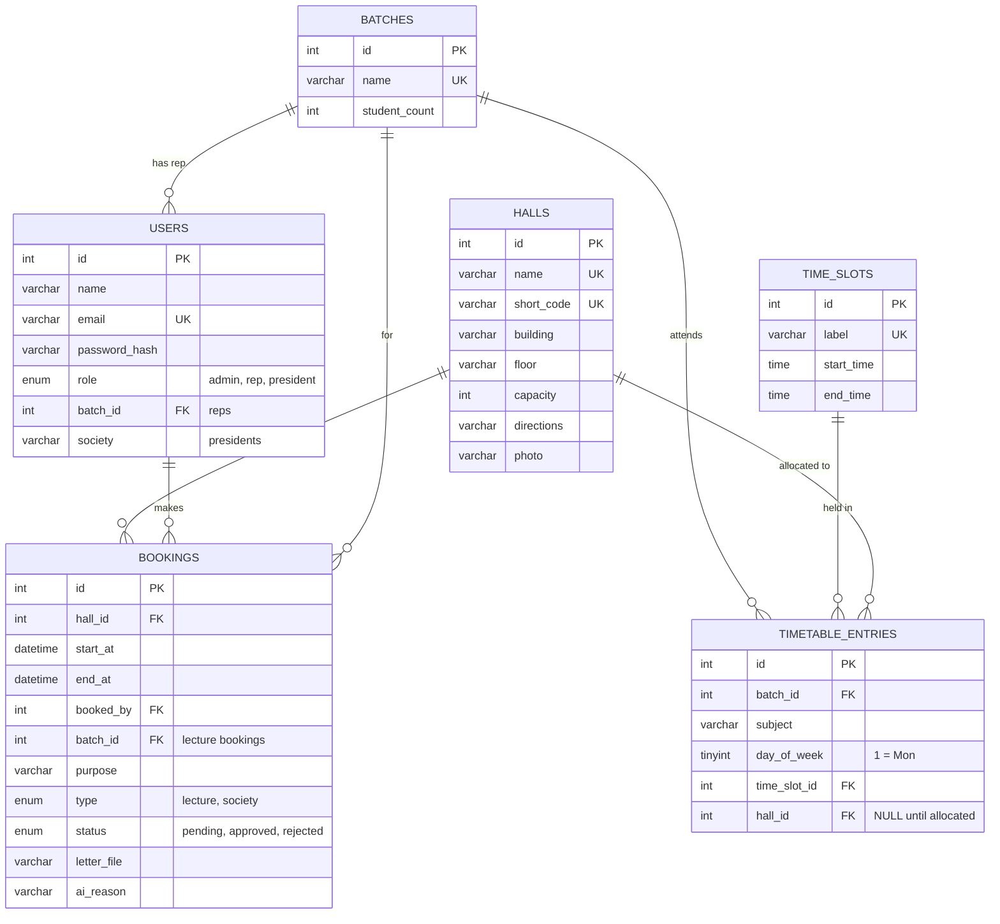

# SmartHall AI

University hall allocation and navigation system for the Faculty of Engineering, University of Ruhuna.
EC4307 Web Application Development mini project.

Batch reps had no system for hall allocation. SmartHall AI lets the admin upload the master timetable and auto-allocate halls. Reps manage their own batch's lectures and bookings, society presidents book halls with an AI-checked permission letter, and students see where every lecture is.

## Features

| Who | What they can do |
|---|---|
| Students (no login) | Weekly timetable per batch with hall locations, hall availability for any date, hall list with directions, chatbot |
| Rep | Edit their own batch's fixed timetable; book, edit and delete halls for their own batch (confirmed instantly if the hall is free and big enough) |
| Society president | Book a hall by uploading the signed, approved permission letter; Claude checks the letter and confirms the booking if it passes |
| Admin | CRUD for halls, batches, time slots and users; upload the master timetable CSV; run auto-allocation; approve, reject or revoke any booking |

- **Auto-allocation:** each lecture gets the smallest free hall that seats the whole batch. Biggest batches are placed first. Lectures that can't be placed are listed.
- **Clash checks:** no hall is double-booked, whether by a fixed lecture or a one-off booking. Overnight events are supported.
- **Chatbot:** rule-based, e.g. *"free halls on 25 Oct at 10am for 120 students"*. It answers from the live database, with directions to each hall.
- **AI letter check:** the letter (PDF/JPG/PNG) and the booking details go to the Claude API. It checks the addressee, the counselor, the society, the venue, the date and time, and the signatures. A pass confirms the booking, and a fail rejects it with the reason. If the API is unavailable, the booking waits for the admin. The AI cannot detect forged signatures, so the admin can revoke any booking.

## Tech stack

Node.js, Express 5, EJS templates, MySQL 8+, express-session, bcryptjs (password hashing), multer (uploads), Anthropic SDK (letter check).

## Setup

1. Install [Node.js](https://nodejs.org) 20+ and MySQL 8+.
2. Install packages:
   ```bash
   npm install
   ```
3. Copy `.env.example` to `.env` and fill in your MySQL password, a session secret, and (optional) an Anthropic API key.
4. Create the database and load the sample data (uses the login in `.env`; this wipes any existing `smarthall` database):
   ```bash
   npm run setup
   ```
   *No MySQL password?* On a Mac with Homebrew MySQL, `npm run db` runs a separate local MySQL just for this project on port 3307 (config in `db/mysql.cnf`). Keep it running in its own terminal, and set `DB_HOST=127.0.0.1` and `DB_PORT=3307` in `.env`.
5. Start the app and open http://localhost:3000 (or the `PORT` you set in `.env`)
   ```bash
   npm start
   ```

**Demo accounts** (password `password123` for all, from `db/seed.js`): `admin@smarthall.test`, `rep.e21@smarthall.test`, `rep.e22@smarthall.test`, `ieee@smarthall.test`.

**Master timetable CSV** (Manage timetable → Upload):
```
batch,subject,day,slot
E21,EE4307 Web Application Development,Mon,08:00-10:00
```

**Tests:** `npm test` runs the unit tests for the chatbot reader, auto-allocation and clash detection.

## Database design (ERD)



The unique keys `(batch_id, day_of_week, time_slot_id)` and `(hall_id, day_of_week, time_slot_id)` stop a batch or a hall having two fixed lectures at once. For one-off bookings, the server checks for overlapping time ranges (`src/clash.js`).

## Project structure

```
app.js            Express setup, sessions, error pages
routes/           auth, public pages + chatbot, halls, timetable, bookings, admin
src/              db pool, role guard, clash checks, auto-allocation, chatbot reader, AI letter check, uploads
views/            EJS pages (partials/ = shared header and footer)
public/style.css  Responsive styles
db/               schema.sql and seed.js
test/             Unit tests
```

## Screenshots

_Add screenshots of the timetable, availability, booking form, admin timetable and chatbot pages here._
